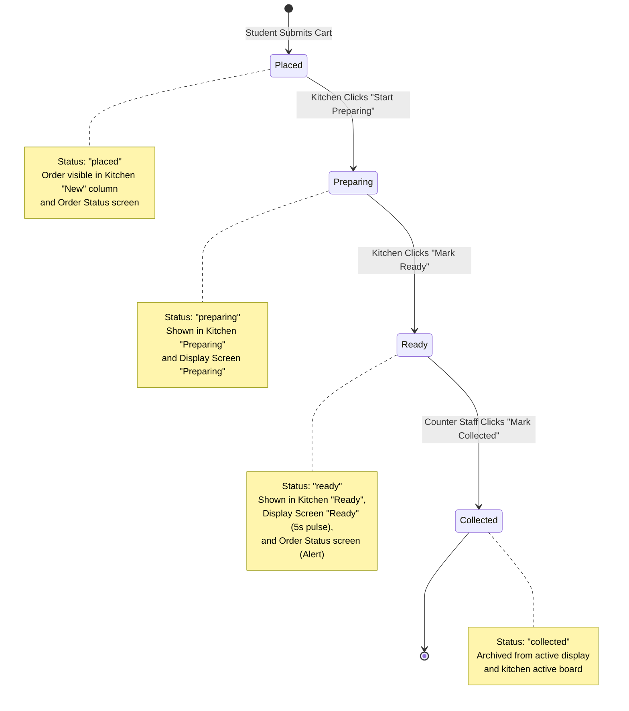
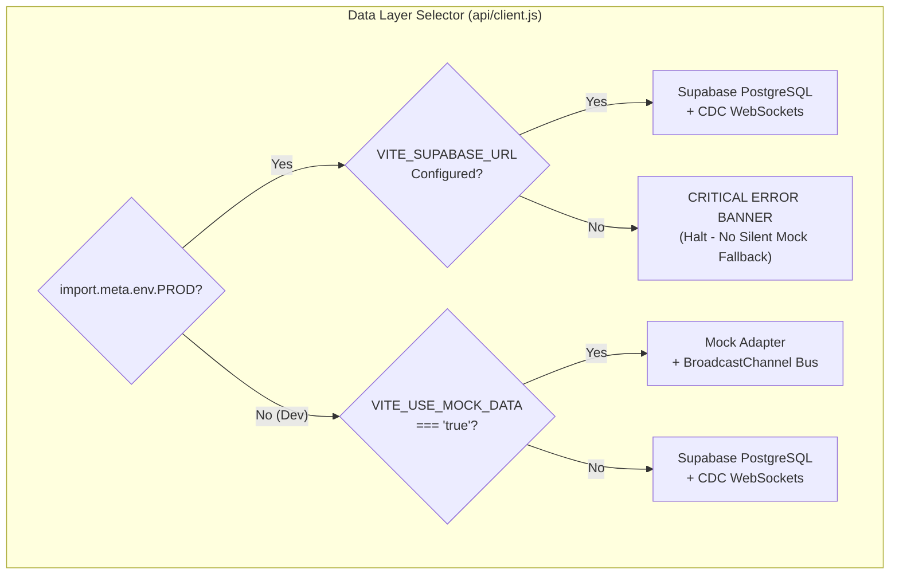
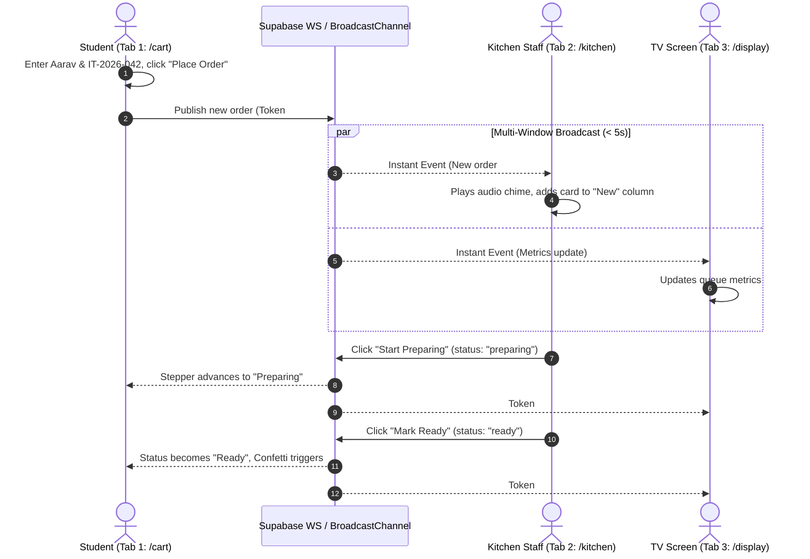

# 03. Business Rules, System Flows & QA Test Checklist
**Project Name:** Canteen Menu & Order Queue System  
**Academic Context:** MSc IT Vibe Coding Lab Project  
**Date:** November 2026 (Updated with Safety Architecture)  

---

## 1. System Invariants & Business Rules Specification

### 1.1 Strict Order Status State Machine
Orders exist in one of four valid states, moving strictly in a forward direction:



#### State Transition Rules:
1. **Forbidden Backward Transitions:** $\text{Ready} \not\to \text{Preparing}$, $\text{Preparing} \not\to \text{Placed}$, $\text{Collected} \not\to \text{Ready}$.
2. Both UI action buttons and database update queries validate the current status before permitting a transition.
3. No order can be deleted by customers after placement.

---

### 1.2 Concurrency-Safe Daily Sequential Token Numbering Logic
- Token numbers reset to **1** each day at **00:00:00 local time**.
- Token formatting: Formatted with a leading `#` and padded to 3 digits (e.g., `#001`, `#002`, ..., `#042`, ..., `#150`).
- **PostgreSQL / Supabase Implementation:**
  - Token allocation runs inside a transactional PostgreSQL stored procedure (`create_canteen_order`) using row-level locking (`SELECT ... FOR UPDATE` on a `daily_sequences` table or transaction-level advisory locks):
    ```sql
    -- Atomic sequence fetch & increment inside single transaction:
    INSERT INTO daily_sequences (sequence_date, last_token)
    VALUES (CURRENT_DATE, 1)
    ON CONFLICT (sequence_date)
    DO UPDATE SET last_token = daily_sequences.last_token + 1
    RETURNING last_token;
    ```
  - This guarantees that two students placing orders at the exact same millisecond will **never receive duplicate tokens**.
- **Mock Mode Implementation:** Synchronized via an atomic counter in `localStorage` guarded by an atomic mutex lock across tabs.

---

### 1.3 Queue Wait-Time Estimation Formula
The estimated waiting time shown on the customer's Order Status screen (`/order/:id`) is calculated dynamically based on the queue depth ahead:

$$\text{Active Orders Ahead} = \text{Count of orders placed before this order with status } \in \{\text{'placed'}, \text{'preparing'}\}$$

$$\text{Estimated Wait Time} = \max(5, (\text{Active Orders Ahead} + 1) \times 5)\text{ minutes}$$

- If an order is currently in the **Ready** state, Estimated Wait Time is **0 minutes** (*"Ready for pickup immediately"*).
- The estimate automatically updates in real time as the kitchen moves tickets forward.

---

### 1.4 Cart & Inventory Constraints
1. **Per-Item Maximum Limit:** A student cannot order more than **10 units** of any single item in a single order:
   $$1 \le \text{Quantity} \le 10$$
2. **Sold-Out Item Real-Time Eviction:**
   - If an item's availability toggle is switched to `is_available = false` while in a student's cart:
     1. The application alerts the student: *"[Item Name] is now sold out and has been removed from your cart."*
     2. The item is automatically removed from the cart and the total is recalculated.
3. **Empty Order Prevention:** Checkout button is strictly disabled if total items $= 0$.

---

### 1.5 Canteen Operational Hours & 4:45 PM Cutoff Rule
- **Standard Canteen Hours:** 08:00 AM – 05:00 PM (17:00).
- **Strict Order Cutoff Time:** **04:45 PM (16:45)**.
- **Rule Enforcement:**
  - When time $\ge 16:45$, the Student Menu displays a top warning banner: *"Orders for today are closed (Cutoff 4:45 PM). Canteen closes at 5:00 PM."*
  - The "Add to Cart" and "Place Order" buttons are disabled.
  - Active orders placed before 16:45 continue through the kitchen board and display board until collected.

---

### 1.6 Dual-Mode Data Layer & Cross-Window Real-Time Specification



#### Parity & Realtime Rules:
1. **Strict Business Rule Parity:** Both `supabaseAdapter` and `mockAdapter` implement the identical interface. Neither adapter is permitted to relax validations or bypass status flow.
2. **Production Fail-Fast:** In production builds (`import.meta.env.PROD`), if Supabase credentials are missing or the connection fails, the application **must immediately display a fatal configuration screen**. Silent fallback to mock data in production is strictly prohibited.
3. **Multi-Window Real-Time Broadcast:**
   - **Supabase Mode:** Real-time push driven by Supabase WebSocket subscriptions on table `orders`.
   - **Mock Mode:** Real-time push driven by the Web **`BroadcastChannel` API** (`canteen_realtime_bus`) backed by `window.addEventListener('storage', ...)`. Placing an order in Window 1 triggers immediate ticket appearance in Window 2 (`/kitchen`) and Window 3 (`/display`) without manual refresh.

---

### 1.7 Safe Demo Controls Architecture
- **Environment Isolation:** Demo controls are active strictly in development (`import.meta.env.DEV === true`) and stripped from production builds.
- **Zero Clock Mutation:** Controls do not alter `window.Date` or the operating system clock. They inject a virtual time offset via `SimulationContext`.
- **Invariants Maintained:** Virtual time is passed through the standard `useCanteenHours` hook, ensuring all business rules (such as 4:45 PM cutoff) are evaluated honestly.

---

### 1.8 Credential & RLS Security Model
- Client code references only public variables: `VITE_SUPABASE_URL` and `VITE_SUPABASE_ANON_KEY`.
- No service role keys or database credentials are ever committed or bundled in client scripts.
- PostgreSQL tables enforce Row Level Security (RLS):
  - `menu_items`: Public read; updates permitted only via manager token or defined update policy.
  - `orders`: Public insert & select; status updates validate forward-only state progression.
  - `daily_sequences`: Managed exclusively via atomic database functions.

---

### 1.9 Mobile Viewport Standards (390px Baseline)
- Layout validated at **390px width** (iPhone 12/13/14).
- Touch target minimum: $44\text{px} \times 44\text{px}$.
- No horizontal scrollbars (`overflow-x-hidden`).
- Clear bottom padding (`pb-28`) on scrollable catalog screens.

---

## 2. End-to-End System Sequence Flows

### 2.1 Multi-Window Real-Time Order Flow



---

## 3. Comprehensive Quality & Test Checklist (14 Tests)

| Test ID | Category | Test Scenario | Execution Steps | Expected Outcome | Pass/Fail Criteria |
| :--- | :--- | :--- | :--- | :--- | :--- |
| **TC-01** | Student Menu | Food Item Catalog Display | Open `/` on desktop & mobile (390px). | Displays $\ge 15$ Indian food items with photo, price in ₹, veg/non-veg dot, category tag, SVG fallback. | All 15+ items render cleanly with zero broken image icons. |
| **TC-02** | Student Menu | Search & Category Filter | Type "Chai", then click category tab "Meals". | First filters only Chai items; clicking "Meals" filters to thalis, biryani, dosas. | Correct items displayed; empty state shown if search term is invalid. |
| **TC-03** | Cart | Item Quantity & Stepper Bounds | Add Samosa to cart, click `+` until 10, then try clicking `+` again. | Quantity increases from 1 to 10; `+` button disables at 10. Clicking `-` decrements quantity. | Cannot exceed 10 units per item; subtotal updates instantly. |
| **TC-04** | Cart | Form Validation & Empty Guard | Attempt to click "Place Order" with empty cart or empty Roll Number. | Place Order button is disabled; input highlights red if touched and blank. | Form prevents invalid submission with zero console errors. |
| **TC-05** | Order Queue | Order Placement & Sequential Token | Add items, input "Aarav Sharma" & "IT-2026-042", click "Place Order". | Submits successfully; redirects to `/order/:id`; displays daily sequential token (e.g., `#001`). | Order created with correct total and sequential token. |
| **TC-06** | Real-Time Sync | Cross-Window Kitchen Order Intake | Open `/kitchen` in Tab 2, place an order on `/cart` in Tab 1. | Within $\le 5$ seconds, ticket appears in the "New" column on Tab 2 with audio chime. | Instant delivery across separate browser windows without manual refresh. |
| **TC-07** | Kitchen Board | Strict Forward Status Flow | On `/kitchen`, click "Start Preparing", then "Mark Ready", then "Mark Collected". | Card moves New $\to$ Preparing $\to$ Ready $\to$ Collected. No option exists to move backward. | Strict progression enforced; completed orders leave active board. |
| **TC-08** | Kitchen Board | 15-Minute Overdue Alert | Inspect an order ticket placed $> 15$ minutes ago (via dev simulation). | Ticket card displays prominent amber-red badge: *"⚠️ Overdue (>15m)"*. | Overdue warning triggers reliably. |
| **TC-09** | Order Status | Live Customer Updates | Keep `/order/:id` open in Tab 1 while kitchen updates status in Tab 2. | Stepper advances from Placed $\to$ Preparing $\to$ Ready. Wait time recalculates. | Updates reflect within 5s; Ready state shows collection prompt and celebration. |
| **TC-10** | TV Display | Fullscreen Now Serving Display | Open `/display` at 1920×1080 resolution. | High-contrast dark theme; displays Preparing tokens on left, Ready tokens on right. | Clean widescreen layout; newly ready token blinks for 5 seconds. |
| **TC-11** | Admin / Owner | Out-of-Stock Toggle & Cart Eviction | In `/admin`, toggle "Pav Bhaji" to Sold Out. In `/`, inspect card; in `/cart`, observe active cart. | Food card shows "Sold Out" overlay & disabled button. In cart, item is evicted with alert toast. | Real-time stock sync works across all connected windows. |
| **TC-12** | Operating Hours | 4:45 PM Cutoff Enforcement | Simulate virtual time at 4:46 PM via dev controls. | System displays cutoff warning banner; "Place Order" button disables with helpful notice. | New orders blocked past 16:45; existing orders continue processing. |
| **TC-13** | Safety & Config | Production Fail-Fast Verification | Simulate production mode with missing Supabase keys. | Application immediately renders a fatal configuration error banner. | Never silently falls back to mock data in production. |
| **TC-14** | Mobile 390px | Responsive Layout Verification | Test all 6 screens at 390px viewport in Chrome DevTools. | All buttons $\ge 44\text{px}$, sticky cart bar does not occlude menu, no horizontal scroll. | Clean mobile layout on all screens. |
