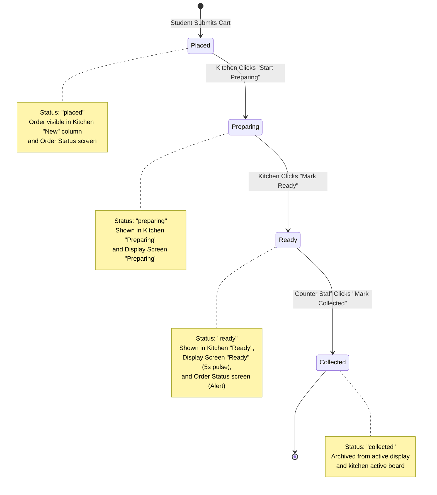
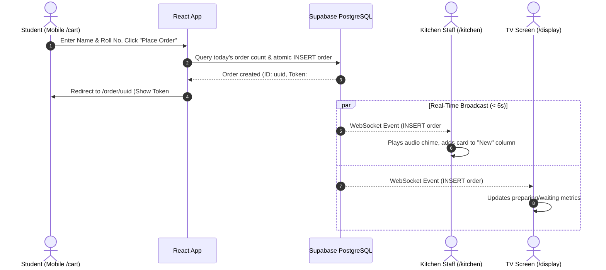
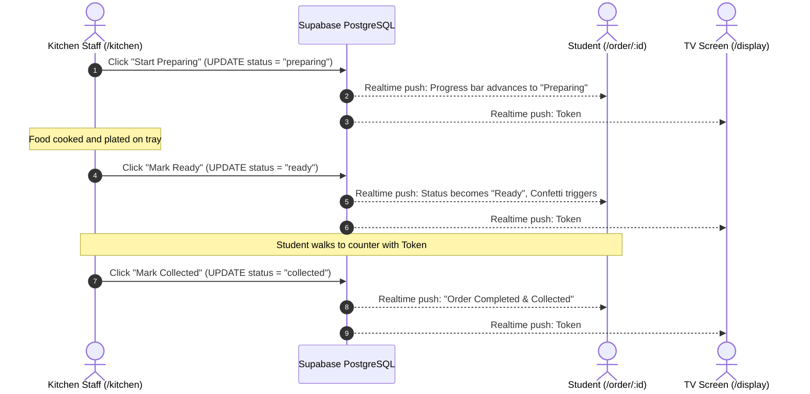

# 03. Business Rules, System Flows & QA Test Checklist
**Project Name:** Canteen Menu & Order Queue System  
**Academic Context:** MSc IT Vibe Coding Lab Project  

---

## 1. System Invariants & Business Rules Specification

### 1.1 Strict Order Status State Machine
Orders exist in one of four valid states, moving strictly in a forward direction:

#### State Transition Rules:
1. **Forbidden Backward Transitions:** $\text{Ready} \not\to \text{Preparing}$, $\text{Preparing} \not\to \text{Placed}$, $\text{Collected} \not\to \text{Ready}$.
2. Both UI action buttons and database update queries validate the current status before permitting a transition.
3. No order can be deleted by customers after placement.

---

### 1.2 Daily Sequential Token Numbering Logic
- Token numbers reset to **1** each day at **00:00:00 local time**.
- Token formatting: Formatted with a leading `#` and padded to 3 digits (e.g., `#001`, `#002`, ..., `#042`, ..., `#150`).
- Token Generation Algorithm:
  $$\text{Token Number} = (\text{Count of orders created today between 00:00:00 and 23:59:59}) + 1$$
- Implemented atomically in the database layer via PostgreSQL sequence or transaction lock to guarantee zero duplicates even under concurrent student submissions.

---

### 1.3 Queue Wait-Time Estimation Formula
The estimated waiting time shown on the customer's Order Status screen (`/order/:id`) is calculated dynamically based on the queue depth ahead:

$$\text{Active Orders Ahead} = \text{Count of orders placed before this order with status } \in \{\text{'placed'}, \text{'preparing'}\}$$

$$\text{Estimated Wait Time} = \max(5, (\text{Active Orders Ahead} + 1) \times 5)\text{ minutes}$$

- If an order is currently in the **Ready** state, Estimated Wait Time is **0 minutes** (*"Ready for pickup immediately"*).
- The estimate automatically updates in real time as the kitchen moves tickets forward.

---

### 1.4 Cart & Inventory Constraints
1. **Per-Item Maximum Limit:** A student cannot order more than **10 units** of any single item in a single order. The UI stepper enforces:
   $$1 \le \text{Quantity} \le 10$$
2. **Sold-Out Item Real-Time Eviction:**
   - If an item's availability toggle is switched to `is_available = false` in the Admin panel while a student has that item in their cart:
     1. The application alerts the student via a toast notification: *"[Item Name] is now sold out and has been removed from your cart."*
     2. The item is automatically removed from the cart and the total is recalculated.
3. **Empty Order Prevention:** Checkout button is strictly disabled if total items $= 0$.

---

### 1.5 Canteen Operational Hours & 4:45 PM Cutoff Rule
- **Standard Canteen Hours:** 08:00 AM – 05:00 PM (17:00).
- **Strict Order Cutoff Time:** **04:45 PM (16:45)**.
- **Rule Enforcement:**
  - After 16:45, the Student Menu displays a top warning banner: *"Orders for today are closed (Cutoff 4:45 PM). Canteen closes at 5:00 PM."*
  - The "Add to Cart" and "Place Order" buttons are disabled.
  - Active orders placed before 16:45 continue through the kitchen board and display board until collected.

---

### 1.6 Real-Time Synchronization & Performance Target
- All screens (Student Menu, Cart, Order Status, Kitchen Board, Display Board, Admin) establish Supabase Realtime subscriptions to the `orders` and `menu_items` tables.
- **Latency Requirement:** Changes must propagate and render on other client devices within **$\le$ 5 seconds** without manual page reloads.
- Reconnection resilience: If the WebSocket connection drops, an automatic polling fallback ensures data refreshes every 5 seconds until the socket reconnects.

---

### 1.7 Currency & Pricing Calculations
- Currency is strictly Indian Rupees (**₹**).
- Subtotal:
  $$\text{Subtotal} = \sum_{i=1}^{n} (\text{item\_price}_i \times \text{quantity}_i)$$
- All calculations are performed using integer cents/paise or strict rounding to ensure no IEEE-754 floating-point inaccuracies appear on student bills.

---

## 2. End-to-End System Sequence Flows

### 2.1 Order Placement & Real-Time Kitchen Dispatch Flow

---

### 2.2 Kitchen Progression & Now Serving Flow

---

## 3. Comprehensive Quality & Test Checklist (12 Tests)

This test matrix must be fully executed and verified before marking the project complete for lab submission:

| Test ID | Category | Test Scenario | Execution Steps | Expected Outcome | Pass/Fail Criteria |
| :--- | :--- | :--- | :--- | :--- | :--- |
| **TC-01** | Student Menu | Food Item Catalog Display | Open `/` on desktop & mobile (390px). | Displays $\ge 15$ Indian food items with photo, price in ₹, veg/non-veg dot, and category tag. | All 15+ items render cleanly with no broken images. |
| **TC-02** | Student Menu | Search & Category Filter | Type "Chai", then click category tab "Meals". | First filters only Chai/tea items; clicking "Meals" filters to thalis, biryani, dosas. | Correct items displayed; empty state shown if search term is invalid. |
| **TC-03** | Cart | Item Quantity & Stepper Bounds | Add Samosa to cart, click `+` until 10, then try clicking `+` again. | Quantity increases from 1 to 10; `+` button disables at 10. Clicking `-` decrements quantity. | Cannot exceed 10 units per item; subtotal updates instantly. |
| **TC-04** | Cart | Form Validation & Empty Guard | Attempt to click "Place Order" with empty cart or empty Roll Number. | Place Order button is disabled; input highlights red if touched and blank. | Form prevents invalid submission with zero console errors. |
| **TC-05** | Order Queue | Order Placement & Sequential Token | Add items, input "Aarav Sharma" & "IT-2026-042", click "Place Order". | Submits successfully; redirects to `/order/:id`; displays daily sequential token (e.g., `#001`). | Order created in Supabase with correct total and sequential token. |
| **TC-06** | Real-Time Sync | Kitchen Board Order Intake | Open `/kitchen` in separate window, place an order on `/cart`. | Within $\le 5$ seconds, ticket appears in the "New" column on `/kitchen` with audio chime. | Instant delivery via Supabase Realtime without manual browser refresh. |
| **TC-07** | Kitchen Board | Strict Forward Status Flow | On `/kitchen`, click "Start Preparing", then "Mark Ready", then "Mark Collected". | Card moves New $\to$ Preparing $\to$ Ready $\to$ Collected. No option exists to move backward. | Strict progression enforced; completed orders leave active board. |
| **TC-08** | Kitchen Board | 15-Minute Overdue Alert | Inspect an order ticket placed $> 15$ minutes ago (or simulated time). | Ticket card displays prominent amber-red badge: *"⚠️ Overdue (>15m)"*. | Overdue warning triggers reliably. |
| **TC-09** | Order Status | Live Customer Updates | Keep `/order/:id` open while kitchen updates status on `/kitchen`. | Stepper advances from Placed $\to$ Preparing $\to$ Ready. Wait time recalculates. | Updates reflect within 5s; Ready state shows collection prompt and celebration. |
| **TC-10** | TV Display | Fullscreen Now Serving Display | Open `/display` at 1920×1080 resolution. | High-contrast dark theme; displays Preparing tokens on left, Ready tokens on right. | Clean widescreen layout; newly ready token blinks for 5 seconds. |
| **TC-11** | Admin / Owner | Out-of-Stock Toggle & Cart Eviction | In `/admin`, toggle "Pav Bhaji" to Sold Out. In `/`, inspect card; in `/cart`, observe active cart. | Food card shows "Sold Out" overlay & disabled button. In cart, item is evicted with alert toast. | Real-time stock sync works across all connected clients. |
| **TC-12** | Operating Hours | 4:45 PM Cutoff Enforcement | Simulate time at 4:46 PM (or set cutoff test toggle). | System displays cutoff warning banner; "Place Order" button disables with helpful notice. | New orders blocked past 16:45; existing orders continue processing. |

---

## 4. Edge Cases & Error Handling

1. **Network Disconnection:**
   - If the student or kitchen loses internet connectivity, an unobtrusive banner displays: *"Connection lost. Attempting to reconnect..."*. Upon reconnection, Supabase re-synchronizes state automatically.
2. **Simultaneous Submissions:**
   - Two students submitting orders at the same second receive distinct, atomic sequential token numbers (`#012` and `#013`) via the database transaction counter.
3. **Menu Item Price Change Mid-Session:**
   - If the owner updates a price in `/admin` while a student has the item in cart, the cart displays a gentle notice: *"Price for [Item] was updated to ₹[New Price]"* and recalculates before submission.
4. **Invalid Route Navigation:**
   - Navigating to a non-existent order ID (e.g., `/order/invalid-uuid`) displays a clean 404 state with a *"Back to Menu"* button.
